# Compiladores – Guía visual de las Unidades I y II

> [!info] Cómo leer esta guía
> Cada tema sigue el mismo orden: **intuición → definición formal → ejemplo resuelto → diagrama**.
> - `> [!abstract]` resume el tema en una frase.
> - `> [!warning] Ojo` señala trampas típicas o **imprecisiones del apunte original**.
> - `> [!tip] 💡 Extra` es contenido que **no está en el apunte** y que se agrega para entender mejor.
> - Convención de los diagramas: los **rectángulos** son *no terminales* (A, S, ⟨expr⟩…) y los **círculos** son *terminales* (a, b, +, 3…).
>
> Fuentes: [[U1_Compiladores.pdf|Unidad I (PDF)]] y [[U2_Compiladores.pdf|Unidad II (PDF)]].

## 🗺️ Mapa de la materia

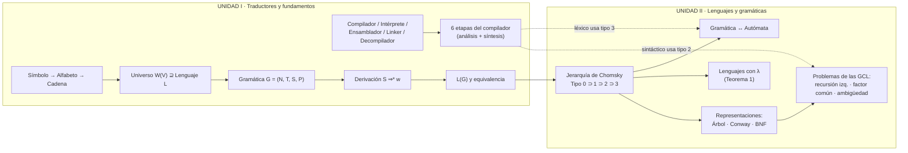

---

# UNIDAD I · Traductores, compiladores e intérpretes

## 1. Conceptos introductorios

> [!abstract] En una frase
> Un **compilador** traduce *todo* un programa de alto nivel a un lenguaje objeto (normalmente código máquina) **antes** de ejecutarlo. Un **intérprete** lo traduce y ejecuta **paso a paso**.

| Concepto | Definición (según el apunte) |
|---|---|
| **Compilación** | Traducción de un programa fuente (alto nivel) a un lenguaje objeto (bajo nivel). |
| **Token / lexema** | Unidad mínima de información. Identificarlos es la tarea del **análisis léxico**. |
| **Sintaxis** | Reglas formales para construir oraciones a partir de los lexemas. |
| **Semántica** | Reglas para analizar el **significado** de las frases. |
| **Intérprete** | Traduce de fuente a objeto *paso por paso*. |
| **Ensamblador** | Compilador sencillo con relación **uno a uno** entre instrucción fuente e instrucción máquina. |
| **Link (enlazar)** | Unir en uno solo varios módulos compilados por separado. |
| **Compilador incremental** (interactivo/conversacional) | Ante un error, continúa desde el punto del error, **sin recompilar todo**. |
| **Decompilador** | Proceso inverso: de bajo nivel a alto nivel. **No recupera el original**: por ejemplo, los comentarios se pierden. |

### Compilador frente a intérprete

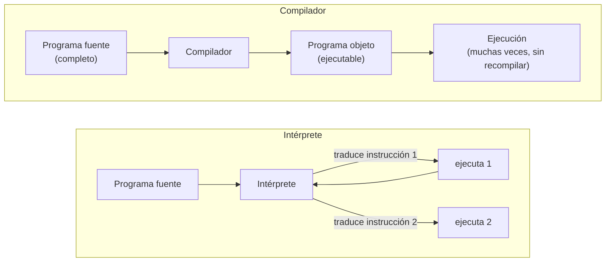

### La cadena completa de traducción

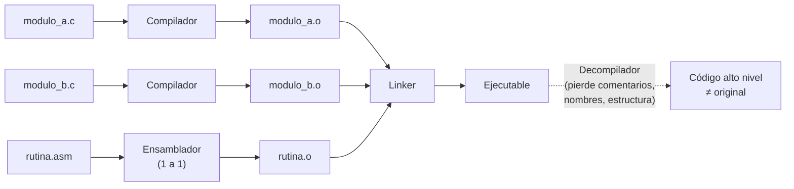

---

## 2. Estructura en etapas de un compilador

> [!abstract] En una frase
> El compilador es una **tubería de 6 etapas**: las 3 primeras **analizan** el programa (¿está bien escrito y tiene sentido?) y las 3 últimas **sintetizan** el programa objeto. Todas comparten la **tabla de símbolos**.

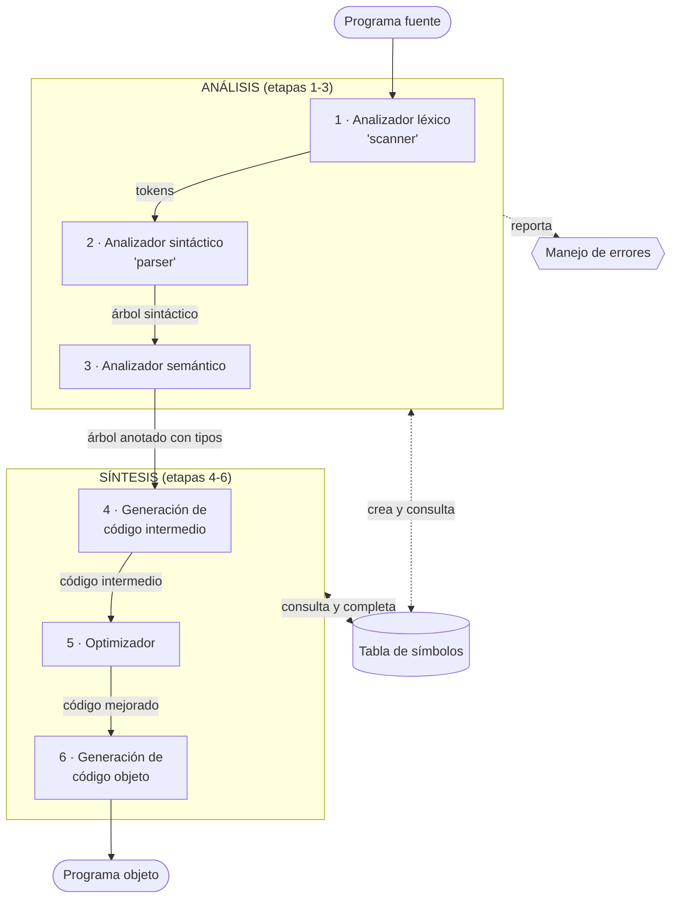

| Etapa | Qué hace | Qué errores detecta | Uso de la tabla de símbolos |
|---|---|---|---|
| 1. Léxico | Separa el texto en **tokens** | Palabras mal escritas, caracteres inválidos | **Crea** las entradas |
| 2. Sintáctico | Comprueba la **estructura de la frase** | Orden o formato incorrecto | Consulta |
| 3. Semántico | Comprueba el **significado** (tipos) | Por ejemplo, restar una cadena de texto | Lee los **tipos** |
| 4. Código intermedio | Traduce a un lenguaje más simple e independiente de la máquina | — | Consulta |
| 5. Optimizador | Elimina redundancias, mejora bucles y saltos, reordena | — | Consulta |
| 6. Código objeto | Genera código de la plataforma destino | — | Guarda **direcciones de memoria** |

> [!note] Del apunte
> El análisis semántico (etapa 3) **también participa** en la generación de código (etapa 4): no es un módulo totalmente aislado.

> [!tip] ¿Por qué existe un código intermedio?
> 1. Facilita la **optimización**.
> 2. Facilita la traducción a **lenguaje máquina**.
> 3. **Compatibilización**: el análisis no depende de la máquina física. Con *N* lenguajes y *M* máquinas se escriben **N + M** módulos en lugar de **N × M** compiladores.

### 💡 Extra: recorrido de una instrucción por las 6 etapas

Supongamos `x = a + b * 2;`, donde `x`, `a` y `b` son de tipo `float`.

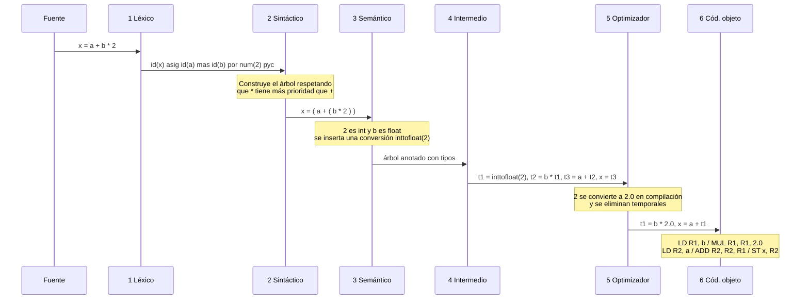

**¿Qué etapa detectaría cada error?**

| Código | Error | Etapa |
|---|---|---|
| `x = 3 @ 2;` | `@` no es un símbolo del lenguaje | 1 · Léxico |
| `x = = 3;` | Orden de tokens inválido | 2 · Sintáctico |
| `x = "hola" - 3;` | No se puede restar a una cadena | 3 · Semántico |

---

## 3. Conceptos de lenguajes formales

> [!abstract] En una frase
> Con **símbolos** se forma un **alfabeto**; con el alfabeto se forman **cadenas**; el conjunto de *todas* las cadenas posibles es el **universo W(V)**, y un **lenguaje** es cualquier subconjunto de ese universo.

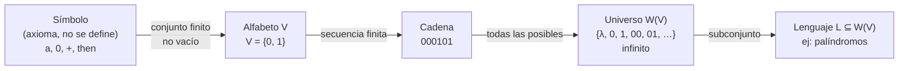

### Definiciones

| Concepto | Definición | Ejemplo |
|---|---|---|
| **Símbolo** | Entidad abstracta básica, como el "punto" en geometría. **Puede tener varias letras.** | `a`, `#`, `+`, `then`, `begin` |
| **Alfabeto (vocabulario) V** | Conjunto **finito y no vacío** de símbolos; se escribe $a \in V$ | $V_3 = \{0,1\}$; $V_4=\{\textbf{if},\textbf{then},a,b,;,=,>\}$ |
| **Cadena** | Secuencia finita de símbolos de un alfabeto | `if a>b then b=a;` sobre $V_4$ |
| **Longitud** $\lvert w \rvert$ | Número de **símbolos** (no de letras) | $\lvert abcb \rvert = 4$ |
| **Cadena vacía** λ | Cadena sin símbolos, $\lvert\lambda\rvert = 0$; existe en **cualquier** alfabeto | — |
| **Concatenación** | $\alpha\beta$: los símbolos de α seguidos de los de β. Neutro: $\alpha\lambda = \lambda\alpha = \alpha$ | `ab`·`ba` = `abba` |
| **Universo** W(V) | Todas las cadenas sobre V, **incluida λ**; siempre es infinito | $V=\{a\}$: $W=\{\lambda,a,aa,\dots\}$ |
| **Lenguaje** | Subconjunto de W(V), definido por **propiedades** y no por enumeración | Palíndromos sobre {0,1} |

> [!warning] Ojo: la longitud cuenta símbolos, no letras
> Sobre $V_4$, la cadena `if a > b then a = b ;` tiene longitud **9**, porque `if` y `then` son **un solo símbolo** cada uno:
> ```mermaid
> flowchart LR
>   s1(("if")) --- s2(("a")) --- s3((">")) --- s4(("b")) --- s5(("then")) --- s6(("a")) --- s7(("=")) --- s8(("b")) --- s9((";"))
> ```

### Lenguaje vacío frente a lenguaje que contiene λ

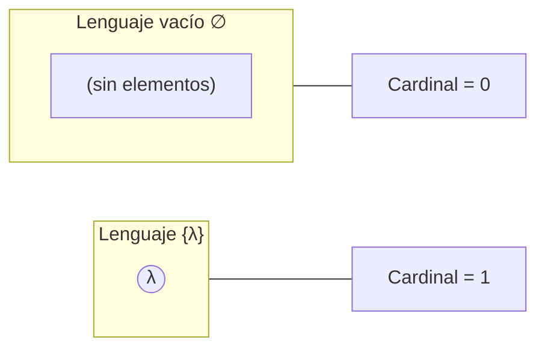

> [!warning] Ojo
> $\emptyset \neq \{\lambda\}$. El primero **no tiene ninguna cadena**; el segundo tiene **una**, la vacía. El apunte escribe el vacío como `{∅}`, pero la notación habitual es simplemente $\emptyset$, porque `{∅}` sería un conjunto con un elemento.

---

## 4. Gramáticas y notación

> [!abstract] En una frase
> Una **gramática** es una forma **finita** de describir un lenguaje que puede ser **infinito**. En un compilador, la gramática define qué instrucciones son válidas.

### Notación de Chomsky: la cuádrupla

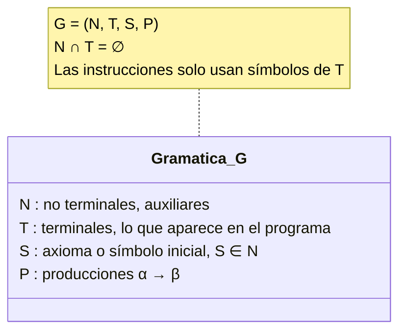

### Convenciones de escritura

| Qué representa | Cómo se escribe | Ejemplos |
|---|---|---|
| No terminales (N) | Mayúsculas del principio del abecedario o `⟨nombres⟩` | `A, B, …, G`, `S` (inicial), `⟨expresión⟩` |
| Terminales (T) | Minúsculas del principio, operadores, dígitos, palabras reservadas en **negrita** | `a, b, c`, `+`, `(`, `0…9`, **if** |
| Símbolo cualquiera (N ∪ T) | Mayúsculas del final | `U, V, W, X, Y, Z` |
| Cadena **solo de terminales** | Minúsculas del final | `t, u, v, x, y, z` |
| Cadena **mixta** | Letras griegas minúsculas | `α, β, γ, δ` |

> [!warning] Ojo
> `y` (letra *ye*, cadena de terminales) ≠ `γ` (*gamma*, cadena mixta).

---

## 5. Derivación

> [!abstract] En una frase
> **Derivar** es partir de **S** y reemplazar repetidamente un lado izquierdo de regla por su lado derecho, hasta que **no quede ningún no terminal**.

Formalmente: si $(\alpha \to \beta) \in P$, entonces $\gamma\alpha\rho \Rightarrow \gamma\beta\rho$ (**derivación directa**). Por eso las reglas se llaman **producciones**: $\gamma\alpha\rho$ *produce* $\gamma\beta\rho$.

> [!warning] Ojo: tres flechas distintas (imprecisión del apunte)
> | Símbolo | Significado |
> |---|---|
> | $\alpha \to \beta$ | **Regla** de producción (pertenece a P) |
> | $\alpha \Rightarrow \beta$ | **Un paso** de derivación |
> | $\alpha \Rightarrow^{*} \beta$ | **Cero o más** pasos |
>
> El apunte escribe `S → aabb`, pero `S → aabb` **no es una regla** de G1. Lo correcto es $S \Rightarrow^{*} aabb$.

### Ejemplo G1: $G_1 = (\{S\}, \{a,b\}, S, P)$, con P: (1) $S\to ab$ y (2) $S \to aSb$

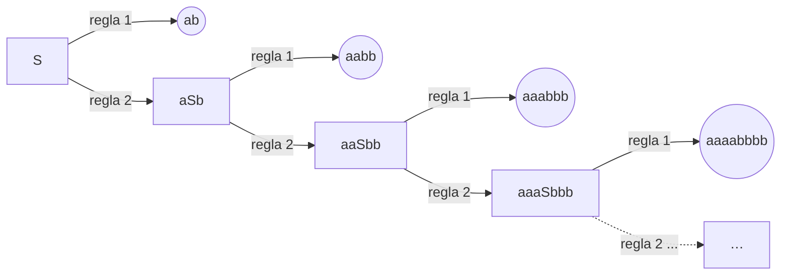

Patrón: la regla 2 **hace crecer** la cadena y la regla 1 **termina** la derivación. $L(G_1) = \{a^n b^n \mid n \ge 1\}$.

### Ejemplo G2: reglas con contexto

$G_2 = (\{S,A,B\}, \{a,b,c,d\}, S, P)$:

| # | Regla | ¿Parte de S? | ¿Qué hace? |
|---|---|---|---|
| 1 | $S \to ASB$ | ✅ | Hace crecer la cadena |
| 2 | $A \to b$ | ❌ | **Cierra** A |
| 3 | $aaA \to aaBB$ | ❌ | Solo se aplica si A está **precedida por `aa`** (contexto) |
| 4 | $S \to d$ | ✅ | **Camino más corto** |
| 5 | $A \to aA$ | ❌ | Hace crecer la cadena |
| 6 | $B \to dcd$ | ❌ | **Cierra** B |

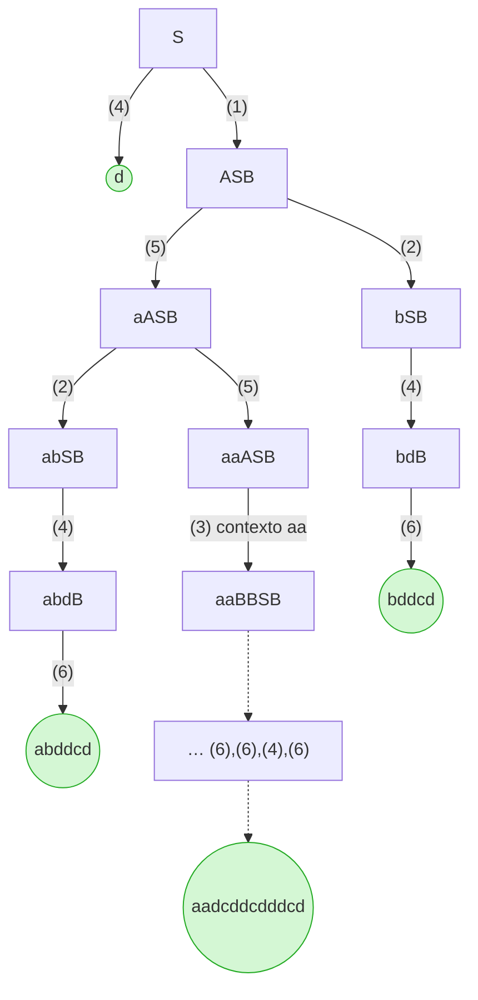

Derivación del apunte, paso a paso:
$$S \overset{1}{\Rightarrow} ASB \overset{5}{\Rightarrow} aASB \overset{2}{\Rightarrow} abSB \overset{4}{\Rightarrow} abdB \overset{6}{\Rightarrow} abddcd$$

> [!tip] Truco de examen
> Las reglas que producen **solo terminales** (2, 4, 6) son las que **terminan** caminos. Las que producen **no terminales** (1, 5) **alargan** la cadena y pueden repetirse indefinidamente. La primera regla aplicada **siempre** debe tener a S sola a la izquierda (aquí, la 1 o la 4).

---

## 6. Instrucciones, lenguaje generado y equivalencia

- **Instrucción** (*sentence*): cadena obtenida desde **S** y formada **solo por terminales**. Ejemplos: `aabb` y `ab` en G1; `abddcd` y `d` en G2.
- **Lenguaje generado**: $L(G) = \{\eta \in T^{*} \mid S \Rightarrow^{*} \eta\}$, es decir, el conjunto de todas las instrucciones.
- **Equivalencia**: $G_1 \equiv G_2 \iff L(G_1) = L(G_2)$. Dos gramáticas distintas pueden generar el mismo lenguaje.

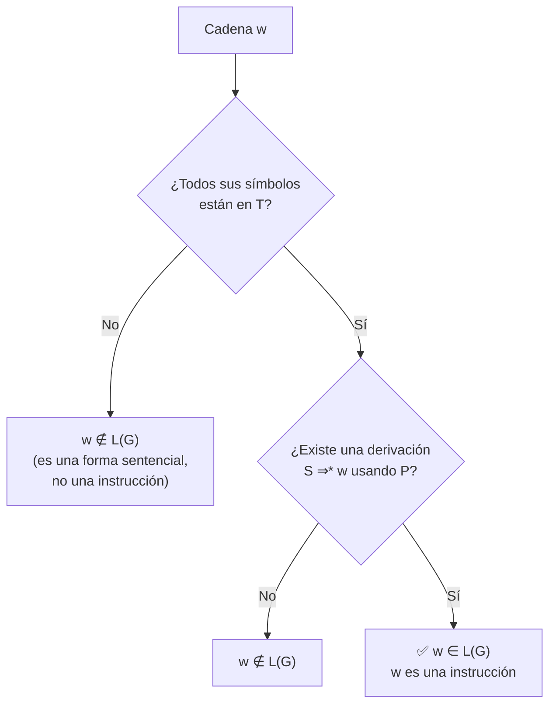

---

## 7. Ejemplos de lenguajes generados (G3 y G4)

### Ejemplo A: $G_3 = (\{S\},\{0,1\},S,P)$, con $P = \{S \to 000S111,\ 0S1 \to 01\}$

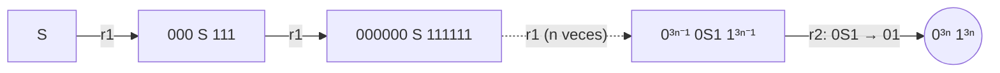

$$L(G_3) = \{0^{3n}1^{3n} \mid n \ge 1\}$$

> [!note] La regla 2 no puede ir primero
> Su lado izquierdo es `0S1`, no `S` sola. Necesita un **contexto** (un 0 antes y un 1 después) que solo aparece después de aplicar la regla 1.

### Ejemplo B: $G_4 = (\{S,A\},\{a,b\},S,P)$

$P = \{S \to abAS,\ abA \to baab,\ S \to a,\ A \to b\}$

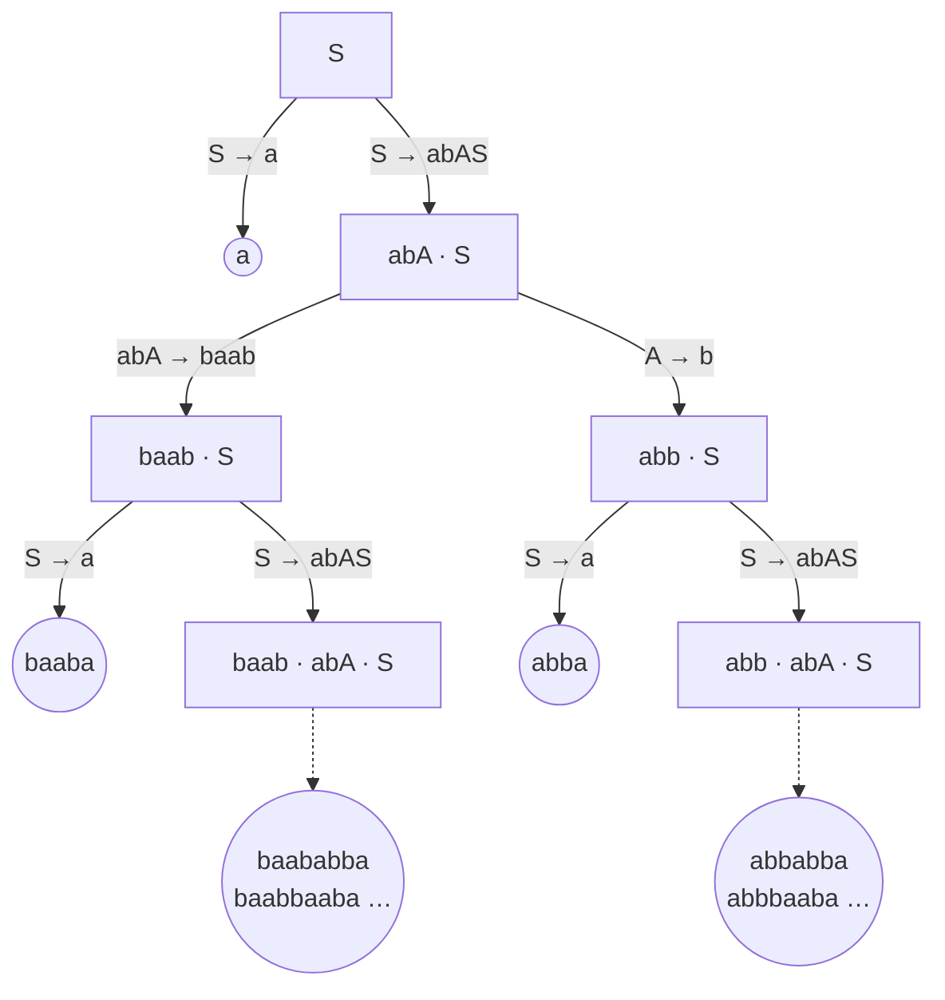

Cada `S → abAS` agrega un **bloque** que termina siendo `abb` o `baab`; al final, `S → a` cierra la cadena.

$$L(G_4) = \{\, w\,a \mid w \text{ es una concatenación de 0 o más bloques } abb \text{ o } baab \,\}$$

> [!note] Conclusión del apunte
> Describir L(G4) en palabras ya resulta engorroso. Por eso aparecen herramientas como las **expresiones regulares**: $L(G_4) = (abb \mid baab)^{*}\,a$.

---

# UNIDAD II · Lenguajes y gramáticas

## 8. Jerarquía de Chomsky

> [!abstract] En una frase
> Chomsky (1959) clasificó las gramáticas en **4 tipos** según **cuánto se restringen sus reglas**. Cuantas más restricciones, **menos lenguajes** se pueden describir, pero **más fácil** es reconocerlos con una máquina.

Esta figura reemplaza la *Ilustración 1* del apunte, con un lenguaje de ejemplo en cada nivel:

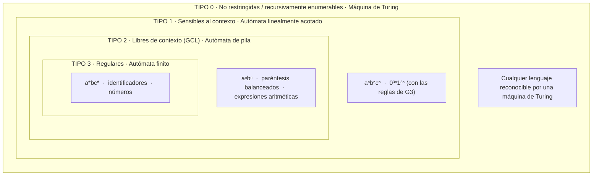

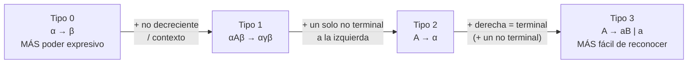

### 8.1 Tipo 0: no restringidas

- **Forma**: $\alpha \to \beta$, sin restricciones (salvo que α **no puede ser vacía**).
- También se llaman *recursivamente enumerables* o *con estructura de frase*.
- **Reconocedor**: **máquina de Turing**.
- Ejemplos: G3 y G4 de la Unidad I.

> [!warning] Ojo (imprecisión del apunte)
> El apunte dice que G3 y G4 son de tipo 0 "pues en ninguna existe la producción λ → β". Lo que significa es que **el lado izquierdo nunca es vacío**, que es la única condición del tipo 0. Por otra parte, G3 contiene la regla `0S1 → 01`, que **acorta** la cadena, así que no puede ser de tipo 1.

### 8.2 Tipo 1: sensibles al contexto

**Forma**:
$$\alpha\, A\, \beta \;\to\; \alpha\, \gamma\, \beta \qquad A \in N;\ \ \alpha,\beta \in (N\cup T)^{*};\ \ \gamma \in (N \cup T)^{+}$$

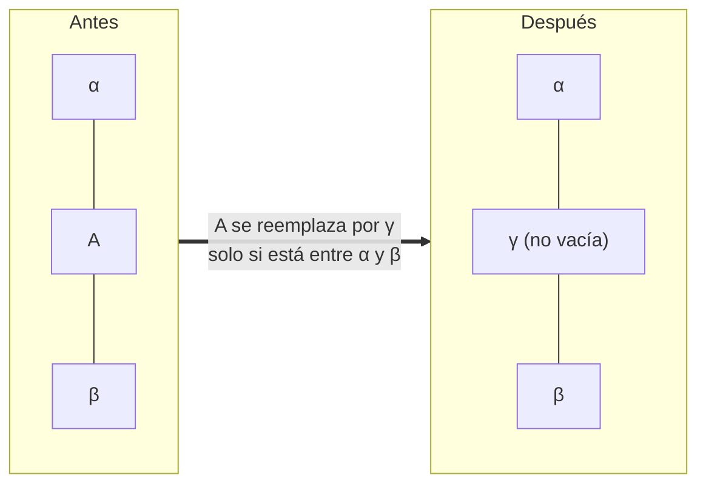

- α y β (el **contexto**) **pueden ser vacíos**; γ **no** puede ser vacía.
- $S \to \lambda$ solo está permitida si **S no aparece a la derecha** de ninguna regla.
- **Reconocedor**: autómata **linealmente acotado** no determinista.

> [!warning] Ojo (imprecisión del apunte)
> El apunte dice "se puede reemplazar A por γ (**un terminal**)". En realidad γ es una **cadena no vacía** de terminales y/o no terminales.

**Ejemplos de tipo 1 del apunte**: G5 (`S → aB | bA`, `A → a | aS | bAA`, `B → b | bS | aBB`) y G6 (`<número> ::= <dígito><número> | <dígito>`).

> [!note] G5 y G6 también son de tipo 2
> Todas sus reglas tienen **un único no terminal a la izquierda**, así que cumplen la forma del tipo 2. Llamarlas "tipo 1" no es incorrecto, porque **todo tipo 2 es también tipo 1** por la inclusión, pero la clasificación **más precisa** es tipo 2. De hecho, G5 aparece repetida más adelante como G9 en la sección de tipo 2.

**Contraejemplo (G7)**: $S \to aaaaSbbbb$, $aSb \to ab$.
La regla `aSb → ab` reemplaza S por **vacío** dentro del contexto a…b, y eso **no está permitido**. Con `S → ab` o `aSb → abb` sí sería de tipo 1.

#### Propiedad de no decrecimiento

$$\alpha \to \beta \;\Rightarrow\; |\beta| \ge |\alpha|$$

*Demostración*: como $|\gamma| \ge 1 = |A|$, se cumple que $|\alpha A \beta| \le |\alpha\gamma\beta|$. ∎
Y a la inversa: si **todas** las reglas son no decrecientes, existe una gramática **equivalente** sensible al contexto. Por eso ambas definiciones son **intercambiables**.

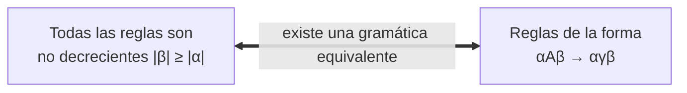

#### Ejemplo G8: $L = \{a^n b^n c^n \mid n \ge 1\}$

Reglas: $S \to aSBC \mid aBC$; $CB \to BC$; $aB \to ab$; $bB \to bb$; $bC \to bc$; $cC \to cc$.

**Derivación completa de `aabbcc`**:

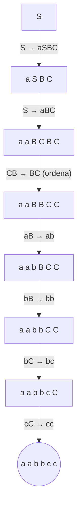

> [!tip] La idea detrás de G8
> 1. `S → aSBC` genera **n** letras `a` y **n** pares `BC`, pero **desordenados** (`BCBC`).
> 2. `CB → BC` **ordena**: mueve todas las B antes que las C.
> 3. Las reglas con contexto (`aB`, `bB`, `bC`, `cC`) convierten de izquierda a derecha los no terminales en terminales.

La regla `CB → BC` es no decreciente pero **no respeta el contexto**, porque cambia dos símbolos a la vez. Se reemplaza por 4 reglas que sí lo respetan:

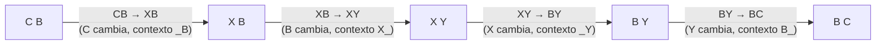

### 8.3 Tipo 2: libres de contexto (GCL) ⭐

> [!important] El tipo más importante para compiladores
> La **sintaxis** de los lenguajes de programación de alto nivel se describe con gramáticas de tipo 2.

- **Forma**: $A \to \alpha$, con $A \in N$ y $\alpha \in (N \cup T)^{+}$. Es decir, **un solo no terminal a la izquierda**.
- Formalmente: $P \subset N \times (N \cup T)^{+}$.
- Se llama **libre de contexto** porque A se reemplaza **sin importar** qué tenga alrededor.
- **Reconocedor**: **autómata de pila** (no determinista).

**Ejemplos**: G9 (igual a G5) y G10 (`<número>`).

Árbol de `<número>` para **"407"** con G10:

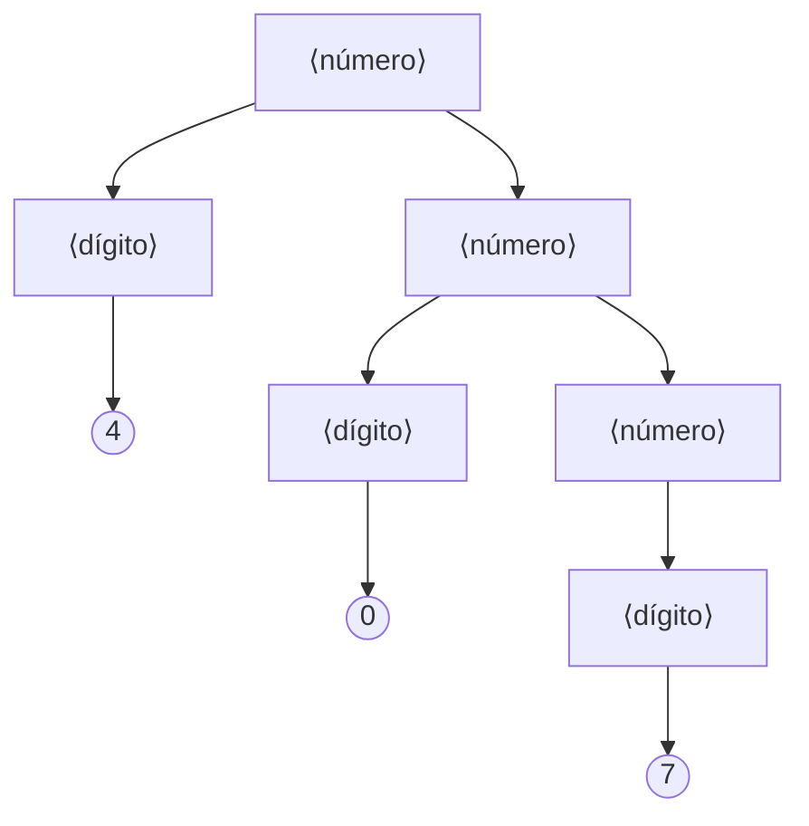

> [!tip] 💡 Extra: ¿qué lenguaje genera G9?
> $S \to aB \mid bA$; $A \to a \mid aS \mid bAA$; $B \to b \mid bS \mid aBB$ genera las cadenas no vacías con **la misma cantidad de `a` que de `b`**. Interpretación: A significa "me falta una `a`" y B significa "me falta una `b`". Es un lenguaje tipo 2 que **no** es regular, porque hay que "contar".

### 8.4 Tipo 3: regulares

- **Forma**: $A \to aB$ o $A \to a$, con $A, B \in N$ y $a \in T$.
- Lado derecho: **un terminal**, opcionalmente seguido de **un** no terminal.
- $S \to \lambda$ está permitida si S no aparece a la derecha de ninguna regla.
- **Reconocedor**: **autómata finito**. Esto es exactamente lo que implementa el **analizador léxico**.

**Ejemplo G11**: $S \to A$; $A \to aA \mid B$; $B \to bC$; $C \to cC \mid \lambda$. Genera $L = a^{*}\,b\,c^{*}$.

> [!warning] Ojo (imprecisión del apunte)
> G11 tiene reglas `S → A` y `A → B` (no terminal → no terminal, llamadas **reglas unitarias**) y `C → λ`. **Ninguna** cumple la forma estricta `A → aB | a` que da el propio apunte. G11 es una gramática **regular extendida**, que siempre se puede convertir en una estricta equivalente:
> $S \to aS \mid bC \mid b$; $C \to cC \mid c$.

**Gramática ↔ autómata**: cada no terminal es un **estado** y cada regla `A → aB` es una **transición** de A a B con la etiqueta `a`.

```mermaid
stateDiagram-v2
  direction LR
  [*] --> SA
  SA --> SA : a
  SA --> C : b
  C --> C : c
  C --> [*]
  note right of SA : S, A y B fusionados<br/>(reglas unitarias)
  note right of C : estado final<br/>porque C → λ
```

---

## 9. Resumen de las gramáticas

| Gramática | Lenguaje | Autómata | Reglas (restricciones) | Ejemplo |
|---|---|---|---|---|
| **Tipo 0** | Recursivamente enumerable o no restringido | Máquina de Turing | $\alpha \to \beta$ (sin restricciones) | G3, G4 |
| **Tipo 1** | Sensible al contexto | Linealmente acotado (ND) | $\alpha A \beta \to \alpha\gamma\beta$ | G8: $a^nb^nc^n$ |
| **Tipo 2** | Libre de contexto | De pila (ND) | $A \to \alpha$ | G9, G10 |
| **Tipo 3** | Regular | Finito | $A \to aB \mid a$ | G11 |

*ND: no determinista.*

```mermaid
flowchart LR
  g0["Gramática Tipo 0"] <-->|"genera / reconoce"| a0["Máquina de Turing<br>cinta infinita"]
  g1["Gramática Tipo 1"] <-->|"genera / reconoce"| a1["Linealmente acotado<br>cinta del tamaño de la entrada"]
  g2["Gramática Tipo 2"] <-->|"genera / reconoce"| a2["Autómata de pila<br>memoria LIFO"]
  g3["Gramática Tipo 3"] <-->|"genera / reconoce"| a3["Autómata finito<br>sin memoria extra"]
  a2 -.->|"en el compilador"| c2["Analizador sintáctico"]
  a3 -.->|"en el compilador"| c3["Analizador léxico"]
```

### 9.1 Figura del apunte: Forma Normal de Chomsky (FNC)

El apunte incluye la captura de un video (*"Gramáticas Libres de Contexto – Algoritmo FNC"*) que **no tiene texto explicativo**. Aquí se reconstruye el contenido. Una GCL está en **FNC** si todas sus reglas son de la forma $A \to BC$ (dos no terminales) o $A \to a$ (un terminal). Toda GCL sin λ se puede llevar a FNC.

> [!tip] Es la misma gramática que G5/G9
> El ejemplo del video (*Selfa*) es exactamente $S \to bA \mid aB$; $A \to bAA \mid aS \mid a$; $B \to aBB \mid bS \mid b$.

```mermaid
flowchart TD
  G["Gramática original<br>S → bA | aB<br>A → bAA | aS | a<br>B → aBB | bS | b"]
  P1["Paso 1: terminales dentro de reglas largas → nuevo no terminal<br>Ca → a , Cb → b<br>S → CbA | CaB<br>A → CbAA | CaS | a<br>B → CaBB | CbS | b"]
  P2["Paso 2: partir los lados derechos de más de 2 símbolos<br>D1 → AA , D2 → BB<br>A → CbD1 | CaS | a<br>B → CaD2 | CbS | b"]
  F["✅ G en FNC: todas las reglas son<br>A → BC  o  A → a"]
  G --> P1 --> P2 --> F
```

> [!note] Utilidad
> En la FNC **todo árbol sintáctico es binario**, lo que simplifica algoritmos de reconocimiento como CYK.

---

## 10. Lenguajes con la cadena vacía

> [!abstract] En una frase
> Las definiciones de los tipos 1, 2 y 3 **no permiten λ**, porque rompería el no decrecimiento. Para agregar λ a un lenguaje se usa **un nuevo símbolo inicial S'** que nunca aparezca a la derecha.

- **Teorema 1**: si G es de tipo 1, 2 o 3, existe una gramática **equivalente** G' del mismo tipo cuyo símbolo inicial **S' no aparece en el lado derecho** de ninguna regla.
- **Corolario 1**: si L es de tipo 1, 2 o 3, entonces $L \cup \{\lambda\}$ y $L - \{\lambda\}$ también lo son.
- **Corolario 2**: a partir de G se puede obtener G' con $S' \to \lambda$ tal que $L(G') = L(G) \cup \{\lambda\}$.

```mermaid
flowchart TD
  A["G = (N, T, S, P)<br>S aparece a la derecha<br>(ej: S → aSb | ab)"] --> B["Teorema 1:<br>agregar un nuevo inicial S'<br>y copiar las reglas de S:<br>S' → α  por cada  S → α"]
  B --> C["G' con S' que nunca<br>aparece a la derecha<br>L(G') = L(G)"]
  C --> D["Corolario 2:<br>agregar S' → λ"]
  D --> E["L(G'') = L(G) ∪ {λ}<br>sin romper el no decrecimiento<br>del resto de la gramática"]
```

*Ejemplo*: $S \to aSb \mid ab$ genera $a^nb^n$ con $n\ge1$. Para incluir λ: $S' \to aSb \mid ab \mid \lambda$ y $S \to aSb \mid ab$, que da $a^nb^n$ con $n \ge 0$.

---

## 11. Relación de inclusión

$$\{L(G_3)\} \subset \{L(G_2)\} \subset \{L(G_1)\} \subset \{L(G_0)\}$$

Cada tipo tiene **restricciones más fuertes** que el anterior, así que **toda gramática de tipo *k* es también de tipo *k − 1***. Las inclusiones son **estrictas**: hay lenguajes en cada nivel que no pertenecen al siguiente.

```mermaid
flowchart LR
  L3["Regulares<br>a*bc*"] -->|"⊂"| L2["Libres de contexto<br>aⁿbⁿ"]
  L2 -->|"⊂"| L1["Sensibles al contexto<br>aⁿbⁿcⁿ"]
  L1 -->|"⊂"| L0["Recursivamente<br>enumerables"]
```

> [!tip] Cómo clasificar una gramática (de la más restrictiva a la menos)
> ```mermaid
> flowchart TD
>   Q0["Gramática G"] --> Q3{"¿Todas las reglas son<br>A → aB o A → a?"}
>   Q3 -- Sí --> R3["Tipo 3"]
>   Q3 -- No --> Q2{"¿Todas tienen un solo<br>no terminal a la izquierda?"}
>   Q2 -- Sí --> R2["Tipo 2"]
>   Q2 -- No --> Q1{"¿Todas son no decrecientes<br>|derecha| ≥ |izquierda|?"}
>   Q1 -- Sí --> R1["Tipo 1"]
>   Q1 -- No --> R0["Tipo 0"]
> ```
> Siempre se responde con el **tipo más alto (más restrictivo)** que cumpla la gramática.

---

## 12. Árbol sintáctico

> [!abstract] En una frase
> Un **árbol sintáctico** dibuja una derivación: la **raíz** es S, cada nodo interno es el **lado izquierdo** de una regla aplicada y sus hijos son los símbolos del **lado derecho**. Las **hojas**, leídas de izquierda a derecha, forman la instrucción.

**Ejemplo del apunte**: $S \to BcdH$, $B \to Hc$, $H \to cd$. La instrucción resultante es `cdccdcd`.

```mermaid
flowchart TD
  S["S"] --> B["B"]
  S --> c1(("c"))
  S --> d1(("d"))
  S --> H1["H"]
  B --> H2["H"]
  B --> c2(("c"))
  H2 --> c3(("c"))
  H2 --> d2(("d"))
  H1 --> c4(("c"))
  H1 --> d3(("d"))
  classDef nt fill:#dbe9ff,stroke:#3366cc;
  classDef t fill:#fff3c4,stroke:#cc9900;
  class S,B,H1,H2 nt;
  class c1,d1,c2,c3,d2,c4,d3 t;
```

### Derivación por la izquierda y por la derecha

- **Por la izquierda**: en cada paso se reemplaza el no terminal (metanoción) **más a la izquierda**.
- **Por la derecha**: en cada paso se reemplaza el no terminal **más a la derecha**.

Ejemplo: $S \to BcdH$, $B \to b$, $H \to h$.

| Paso | Por la izquierda | Por la derecha |
|---|---|---|
| 0 | **S** | **S** |
| 1 | **B** c d H | B c d **H** |
| 2 | b c d **H** | **B** c d h |
| 3 | b c d h | b c d h |

```mermaid
flowchart TD
  S["S"] --> B["B<br>izq: 1.º · der: 2.º"]
  S --> c(("c"))
  S --> d(("d"))
  S --> H["H<br>izq: 2.º · der: 1.º"]
  B --> b(("b"))
  H --> h(("h"))
  classDef nt fill:#dbe9ff,stroke:#3366cc;
  classDef t fill:#fff3c4,stroke:#cc9900;
  class S,B,H nt;
  class b,c,d,h t;
```

> [!note] Mismo árbol, distinto orden
> Las dos derivaciones producen **el mismo árbol**; solo cambia el **orden** en que se expanden B y H. Si para una misma instrucción existieran **árboles distintos**, la gramática sería **ambigua** (ver §15.3).

---

## 13. Diagrama de Conway (sintáctico)

> [!abstract] En una frase
> Es un **grafo dirigido** que representa reglas de producción: los **rectángulos** son no terminales y los **círculos** son terminales. Se usó por primera vez para describir **PASCAL**.

**Figura del apunte**: una lista de identificadores entre paréntesis, separados por `;`, por ejemplo `(x ; y ; z)`.

```mermaid
flowchart LR
  ini((" ")) --> p1(("("))
  p1 --> id["identificador"]
  id --> p2((")"))
  p2 --> fin((" "))
  id --> sc((";"))
  sc --> id
```

La regla BNF equivalente es $\langle lista\rangle \to (\ \langle ids\rangle\ )$ con $\langle ids\rangle \to \text{identificador} \mid \text{identificador}\ ;\ \langle ids\rangle$.

**💡 Extra**: diagrama de Conway de la gramática del número decimal de la §14:

```mermaid
flowchart LR
  subgraph rL["L"]
    direction LR
    l0((" ")) --> N1["N"]
    N1 --> l1((" "))
    N1 -->|"repetir"| N1
  end
  subgraph rD["D"]
    direction LR
    d0((" ")) --> L1["L"]
    L1 --> d1((" "))
    L1 --> pt(("."))
    pt --> L2["L"]
    L2 --> d1
  end
  subgraph rS["S"]
    direction LR
    s0((" ")) --> neg(("-"))
    s0 --> D1["D"]
    neg --> D1
    D1 --> s1((" "))
  end
```

---

## 14. Notación Backus-Naur (BNF)

> [!abstract] En una frase
> **BNF** es una notación formal para escribir gramáticas **libres de contexto (tipo 2)** sin ambigüedad en la *descripción*. La creó **John Backus** (a partir de trabajos de Emil Post) y la mejoró **Peter Naur** para describir **Algol 60**.

**Forma de una regla**:
```
símbolo → alternativa1 | alternativa2 | ... | alternativaN
símbolo ::= alternativa1 | alternativa2 | ...      (notación alternativa)
```

A partir de una gramática en BNF se puede **construir mecánicamente** un reconocedor sintáctico, aunque algunas gramáticas deben **modificarse antes** (ver §15).

**Ejemplo del apunte**: números decimales.

```
S → -D | D          (S: número con signo opcional)
D → L | L . L       (D: decimal; el punto es opcional)
L → N | N L         (L: lista de dígitos)
N → 0 | 1 | 2 | 3 | 4 | 5 | 6 | 7 | 8 | 9
```

Árbol para **"33.5"** (reconstrucción de la figura del apunte):

```mermaid
flowchart TD
  S["S"] --> D["D"]
  D --> L1["L"]
  D --> pt(("."))
  D --> L3["L"]
  L1 --> N1["N"]
  L1 --> L2["L"]
  N1 --> t3a(("3"))
  L2 --> N2["N"]
  N2 --> t3b(("3"))
  L3 --> N3["N"]
  N3 --> t5(("5"))
  classDef nt fill:#dbe9ff,stroke:#3366cc;
  classDef t fill:#fff3c4,stroke:#cc9900;
  class S,D,L1,L2,L3,N1,N2,N3 nt;
  class pt,t3a,t3b,t5 t;
```

Derivación por la izquierda:
$S \Rightarrow D \Rightarrow L.L \Rightarrow NL.L \Rightarrow 3L.L \Rightarrow 3N.L \Rightarrow 33.L \Rightarrow 33.N \Rightarrow 33.5$

---

## 15. Problemas de las GCL (tipo 2)

> [!abstract] En una frase
> Una GCL puede describir bien un lenguaje y aun así **no servir para construir un analizador**. Hay tres problemas típicos: **recursividad por la izquierda**, **factor común a la izquierda** y **ambigüedad**. Los tres se resuelven **reescribiendo la gramática sin cambiar el lenguaje**.

### Tipos de recursividad

Dada una regla $A \to \alpha A \beta$:

```mermaid
flowchart TD
  R["A → α A β"] --> Q{"¿α y β<br>son vacías?"}
  Q -->|"α = λ"| I["A → Aβ<br>Recursiva por la IZQUIERDA ⚠️"]
  Q -->|"β = λ"| D["A → αA<br>Recursiva por la DERECHA ✅"]
  Q -->|"α ≠ λ y β ≠ λ"| AU["A → αAβ<br>AUTOIMBRICADA<br>(ej: S → aSb)"]
```

### 15.1 Problema 1: recursividad por la izquierda

**¿Por qué es un problema?** El análisis se hace de **izquierda a derecha**. Un parser descendente que intenta expandir `E → E + T` llama otra vez a E **sin haber consumido ningún token** y entra en un **bucle infinito**:

```mermaid
sequenceDiagram
  participant P as Parser
  participant E as procedimiento E()
  P->>E: E() (entrada x + x)
  E->>E: aplica E → E + T y llama a E()
  E->>E: aplica E → E + T y llama a E()
  E->>E: aplica E → E + T y llama a E()
  Note over E: no se consume ningún token<br/>recursión infinita (stack overflow)
```

**Transformación general**: si
$$A \to A\alpha_1 \mid A\alpha_2 \mid \dots \mid A\alpha_q \mid \beta_1 \mid \beta_2 \mid \dots \mid \beta_p$$
se reescribe como
$$A \to \beta_j A' \quad (1 \le j \le p) \qquad A' \to \alpha_i A' \mid \lambda \quad (1 \le i \le q)$$

```mermaid
flowchart LR
  subgraph ANT["Antes: recursiva por la izquierda"]
    a["A → Aα | β<br>genera: β α α α …<br>(crece hacia la izquierda)"]
  end
  subgraph DES["Después: recursiva por la derecha"]
    b["A → β A'<br>A' → α A' | λ<br>genera: β α α α …<br>(crece hacia la derecha)"]
  end
  ANT ==>|"mismo lenguaje: β α*"| DES
```

**Ejemplo simple**: $A \to Aa \mid Ab \mid c \mid d$ se convierte en $A \to cA' \mid dA'$ con $A' \to aA' \mid bA' \mid \lambda$.

**Variante sin reglas λ**: $A \to \beta_j \mid \beta_j A'$ y $A' \to \alpha_i \mid \alpha_i A'$.

**Ejemplo clásico (expresiones aritméticas)**:

| Antes | Después |
|---|---|
| $E \to E + T \mid T$ | $E \to T E'$ <br> $E' \to +TE' \mid \lambda$ |
| $T \to T * F \mid F$ | $T \to F T'$ <br> $T' \to *FT' \mid \lambda$ |
| $F \to (E) \mid x$ | $F \to (E) \mid x$ |

Árbol de `x + x` con la gramática transformada:

```mermaid
flowchart TD
  E["E"] --> T1["T"]
  E --> E1["E'"]
  T1 --> F1["F"]
  T1 --> T1p["T'"]
  F1 --> x1(("x"))
  T1p --> l1(("λ"))
  E1 --> plus(("+"))
  E1 --> T2["T"]
  E1 --> E2["E'"]
  T2 --> F2["F"]
  T2 --> T2p["T'"]
  F2 --> x2(("x"))
  T2p --> l2(("λ"))
  E2 --> l3(("λ"))
```

### 15.2 Problema 2: factor común a la izquierda

Si $A \to \alpha B \mid \alpha C$, al leer α **no se sabe qué regla elegir**. Se **factoriza**: $A \to \alpha A'$ con $A' \to B \mid C$.

```mermaid
flowchart LR
  subgraph ANTES["Antes: ¿qué alternativa sigo?"]
    A1["A"] --> X1["α B"]
    A1 --> X2["α C"]
  end
  subgraph DESPUES["Después: la decisión se posterga"]
    A2["A"] --> AL["α A'"]
    AL --> Y1["B"]
    AL --> Y2["C"]
  end
  ANTES ==>|"factorizar α"| DESPUES
```

> [!example] 💡 Extra: el caso real del `if`
> `I → if E then S | if E then S else S` comparte el prefijo `if E then S`.
> Factorizado queda: `I → if E then S I'` con `I' → else S | λ`.

### 15.3 Problema 3: ambigüedad

> [!important] Definición
> Una gramática G es **ambigua** si existe **alguna instrucción** con **más de un árbol sintáctico**. La ambigüedad es una propiedad **de la gramática, no del lenguaje**. Con una gramática ambigua **no se puede implementar un analizador**, pero **siempre** se puede reescribir conservando el mismo lenguaje.

**Ejemplo G12**: $S \to a \mid S+S \mid S*S$. La instrucción `a*a+a` tiene **dos árboles** (reconstrucción de la figura del apunte):

**Árbol 1: `(a*a)+a`** ✅ respeta la prioridad matemática (primero se aplica `S → S+S`)

```mermaid
flowchart TD
  S1["S"] --> S2["S"]
  S1 --> p1(("+"))
  S1 --> S3["S"]
  S2 --> S4["S"]
  S2 --> m1(("*"))
  S2 --> S5["S"]
  S4 --> a1(("a"))
  S5 --> a2(("a"))
  S3 --> a3(("a"))
  classDef nt fill:#dbe9ff,stroke:#3366cc;
  classDef t fill:#fff3c4,stroke:#cc9900;
  class S1,S2,S3,S4,S5 nt;
  class p1,m1,a1,a2,a3 t;
```

**Árbol 2: `a*(a+a)`** ❌ tiene otro significado (primero se aplica `S → S*S`)

```mermaid
flowchart TD
  T1["S"] --> T2["S"]
  T1 --> m2(("*"))
  T1 --> T3["S"]
  T2 --> b1(("a"))
  T3 --> T4["S"]
  T3 --> p2(("+"))
  T3 --> T5["S"]
  T4 --> b2(("a"))
  T5 --> b3(("a"))
  classDef nt fill:#dbe9ff,stroke:#3366cc;
  classDef t fill:#fff3c4,stroke:#cc9900;
  class T1,T2,T3,T4,T5 nt;
  class m2,p2,b1,b2,b3 t;
```

Con $a = 2$: el árbol 1 da $2\cdot2+2 = 6$ y el árbol 2 da $2\cdot(2+2) = 8$. **El significado cambia**, y por eso el compilador necesita un único árbol.

**Soluciones como "mecanismo externo"** (sin reescribir la gramática):
1. Dar **mayor prioridad** al producto que a la suma.
2. Con igual prioridad, **obligar a usar paréntesis**.

**💡 Extra: solución reescribiendo la gramática.** Se crea un nivel de gramática por cada nivel de prioridad:

```mermaid
flowchart TD
  G12["G12 ambigua<br>S → a | S+S | S*S"] -->|"1 nivel por prioridad"| GE["E → E + T | T<br>T → T * F | F<br>F → (E) | a<br>NO ambigua, pero con recursión izquierda"]
  GE -->|"eliminar la recursión izquierda (§15.1)"| GF["E → T E'<br>E' → + T E' | λ<br>T → F T'<br>T' → * F T' | λ<br>F → (E) | a<br>✅ lista para un parser descendente"]
```

> [!tip] Así se conecta toda la Unidad II
> **Gramática ambigua → gramática por niveles de prioridad → eliminación de la recursividad izquierda → gramática apta para un parser.** Es exactamente el ejemplo `E/T/F` del apunte: cada problema de las GCL se resuelve con una transformación que **conserva el lenguaje**.

---

## 16. Ejercicios de práctica

> [!question] Ejercicio 1: longitud
> Sobre $V_4 = \{\textbf{if},\textbf{then},\textbf{begin},\textbf{end},\textbf{else},a,b,;,=,>\}$, ¿cuál es $\lvert \textbf{if}\ a>b\ \textbf{then}\ b=a; \rvert$?

> [!faq]- Solución 1
> **9** símbolos: `if`, `a`, `>`, `b`, `then`, `b`, `=`, `a`, `;`.

> [!question] Ejercicio 2: ¿qué etapa detecta el error?
> a) `int 9x = 3;`  b) `while (x > 3 {`  c) `bool b = 3 * "hola";`

> [!faq]- Solución 2
> a) **Léxico**: `9x` no es un token válido (un identificador no puede empezar con un dígito).
> b) **Sintáctico**: falta `)`.
> c) **Semántico**: tipos incompatibles.

> [!question] Ejercicio 3: clasificar gramáticas
> a) $S \to aS \mid b$  b) $S \to aSb \mid ab$  c) $S \to aSBC \mid aBC,\ CB \to BC, \dots$ (G8)  d) $S \to aaaaSbbbb,\ aSb \to ab$ (G7)

> [!faq]- Solución 3
> a) **Tipo 3**: `A → aB | a`; genera $a^{*}b$.
> b) **Tipo 2**: un solo no terminal a la izquierda, pero `aSb` no tiene la forma regular; genera $a^nb^n$.
> c) **Tipo 1**: no decreciente, con más de un símbolo a la izquierda.
> d) **Tipo 0**: `aSb → ab` decrece de longitud 3 a 2.

> [!question] Ejercicio 4: eliminar la recursividad por la izquierda
> $L \to L\ ,\ id \mid id$

> [!faq]- Solución 4
> Corresponde a la forma $A \to A\alpha \mid \beta$, con $\alpha = {,}\,id$ y $\beta = id$.
> $L \to id\ L'$ con $L' \to ,\ id\ L' \mid \lambda$.

> [!question] Ejercicio 5: factorizar
> $T \to id \mid id\,[\,E\,] \mid id\,(\,E\,)$

> [!faq]- Solución 5
> $T \to id\ T'$ con $T' \to \lambda \mid [\,E\,] \mid (\,E\,)$.

> [!question] Ejercicio 6: árbol con BNF
> Con la gramática del número decimal (§14), dibuja el árbol de **"-7.25"**.

> [!faq]- Solución 6
> ```mermaid
> flowchart TD
>   S["S"] --> m(("-"))
>   S --> D["D"]
>   D --> L1["L"]
>   D --> pt(("."))
>   D --> L2["L"]
>   L1 --> N1["N"]
>   N1 --> t7(("7"))
>   L2 --> N2["N"]
>   L2 --> L3["L"]
>   N2 --> t2(("2"))
>   L3 --> N3["N"]
>   N3 --> t5(("5"))
> ```

> [!question] Ejercicio 7: ambigüedad
> ¿Es ambigua la gramática $S \to SS \mid a$? Justifica con la instrucción `aaa`.

> [!faq]- Solución 7
> **Sí**. `aaa` tiene dos árboles: $(aa)a$, donde el primer S se expande en SS, y $a(aa)$, donde se expande el segundo. Una alternativa no ambigua es $S \to aS \mid a$, que genera el mismo lenguaje $a^{+}$.

> [!question] Ejercicio 8: lenguaje con λ
> Dada $S \to aSb \mid ab$, construye G' tal que $L(G') = L(G) \cup \{\lambda\}$.

> [!faq]- Solución 8
> Como S aparece a la derecha, se crea S' (Teorema 1):
> $S' \to aSb \mid ab \mid \lambda$ con $S \to aSb \mid ab$. Así S' nunca aparece a la derecha y $L(G') = \{a^nb^n \mid n \ge 0\}$.

---

## 📚 Bibliografía

- Arcay, B.; Dafonte, C. *Compiladores*. Depto. de Tecnologías de la Información y Comunicaciones, Universidad de Coruña, 2010.
- Aho, A. V.; Lam, M. S.; Sethi, R.; Ullman, J. D. *Compiladores: principios, técnicas y herramientas*. 2.ª ed. Pearson Addison Wesley, 2008.
- Cueva Lovelle, J. M. *Lenguajes, gramáticas y autómatas*. 2.ª ed. Oviedo, 2001 (fuente de la Ilustración 1).
- Fernández, G.; Sáez Vacas, F. *Fundamentos de Informática*, 1987 (demostraciones del Teorema 1 y de la sensibilidad al contexto).
